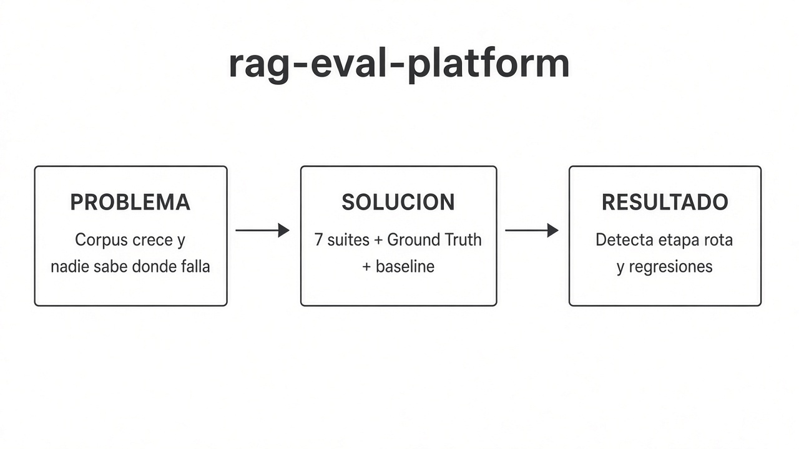
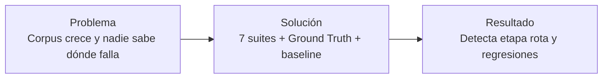

<div align="center">

# rag-eval-platform

**Evaluación local de sistemas RAG** · Angel Salazar · Nivel 3

`extracción → chunking → retrieval → ground truth → faithfulness → citas → abstención`

<br/>


</div>

---

### `$ cat diagrama.md`



Arquitectura completa: [`docs/architecture.md`](docs/architecture.md)

---

### `$ cat problema.md`

En sistemas RAG reales el dolor no es “que el modelo suene inteligente”.  
El dolor aparece cuando el corpus crece y nadie sabe **en qué etapa se rompió**.

| Problema | En la práctica | Aquí |
|---|---|---|
| Evaluación superficial | 3 preguntas a mano | Ground Truth + 7 suites |
| Caja negra | Falla el producto sin saber si fue extract/chunk/retrieve | Suites por etapa |
| Alucinaciones | Responde sin respaldo | Faithfulness + citation |
| No sabe callarse | Inventa sin evidencia | Abstention |
| Regresiones | Una “mejora” empeora retrieval | Baseline + A/B |

**Hipótesis:** con GT fijo y baseline, un cambio de corpus o de chunking deja evidencia medible (no opinión).

---

### `$ cat experimento.md`

Detalle: [`docs/EXPERIMENT.md`](docs/EXPERIMENT.md)

| | scenario_a (4 docs) | scenario_b (6 docs) | Delta |
|---|---:|---:|---:|
| overall | **89.7%** | **97.7%** | +8 |
| ground_truth | 83% | 100% | +17 |
| faithfulness | 89% | 100% | +11 |
| citation | 83% | 100% | +17 |
| abstention | 85% | 83% | -2 |

Más docs no es gratis: sube calidad de respuesta en este sample, pero abstención puede aflojar.

---

### `$ cat conclusions.md`

Detalle: [`docs/CONCLUSIONS.md`](docs/CONCLUSIONS.md)

- Aprobaría: gate por suite + baseline obligatorio antes de merge.
- Rechazaría: demos manuales y cambiar de modelo sin rerun.
- Contrato de salida: JSON en `results/` consumible por [`llm-ci-gates`](https://github.com/Angelzaki/llm-ci-gates).

---

### `$ make local`

```bash
python -m venv .venv
.venv\Scripts\activate   # Windows
pip install -e .
pytest
python -m rag_eval --scenario scenario_a --save-baseline
python -m rag_eval --scenario scenario_a
python scripts/compare_ab.py
```

Docker:

```bash
docker compose run --rm eval
docker compose --profile test run --rm test
```

CI: `.github/workflows/ci.yml` → pytest + eval + artifact de `results/`.

---

### `$ cat aws.md` (referencia, sin credenciales)

```text
GitHub Actions → métricas JSON
       │
       ▼
 llm-ci-gates (PASS/FAIL)
       │
       └── opcional: ECR + ECS batch + S3 results
```

Datos solo sintéticos en `samples/`. Cero documentos internos.

---

### `$ ls related`

**Ecosistema:** [`llm-ci-gates`](https://github.com/Angelzaki/llm-ci-gates) · [`knowledge-ops-console`](https://github.com/Angelzaki/knowledge-ops-console) · [`local-rag-pipeline`](https://github.com/Angelzaki/local-rag-pipeline)

**Labs satélite:** `chunk-lab` · `retrieval-tuner-local` · `abstention-lab-local` · `faithfulness-guard` · `citation-auditor-local` · `eval-hub-local`

---

Hecho en Lima · Angel Salazar · CIP 404730
