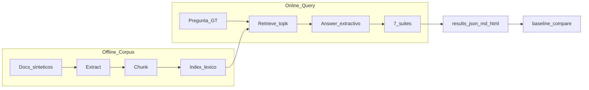
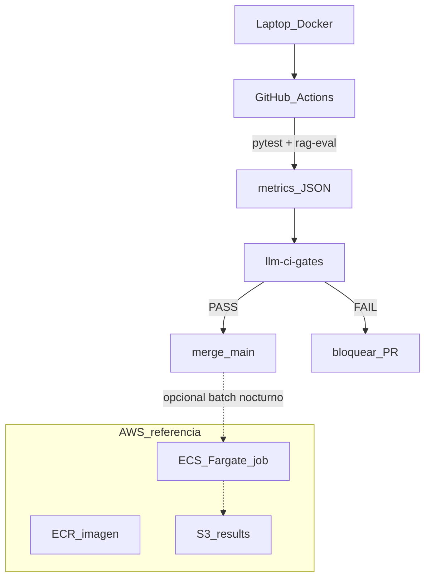

# Arquitectura · rag-eval-platform

Evaluación local de un pipeline RAG por etapas. Sin APIs de pago obligatorias.

## Offline vs online (qué medimos)

## Suites por etapa

| Etapa | Suite | Falla típica que detecta |
|---|---|---|
| Lectura | `extraction` | archivo vacío / no leído |
| Fragmentación | `chunking` | doc sin cobertura de chunks |
| Búsqueda | `retrieval` | top-k sin el doc fuente |
| Respuesta | `ground_truth` | no se acerca a lo esperado |
| Fidelidad | `faithfulness` | claims sin respaldo |
| Citas | `citation` | cita a doc incorrecto |
| Silencio | `abstention` | inventa sin evidencia |

## Despliegue documentado (AWS, sin credenciales)

En este repo el camino productivo es **local + CI**. AWS queda como mapa: imagen Docker en ECR, job batch que escribe métricas en S3, y el mismo contrato JSON que consume `llm-ci-gates`.
